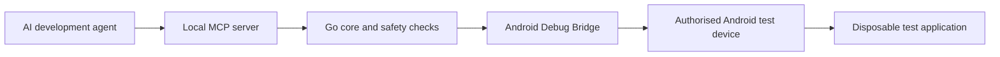

# DroidCommand

**Real Android devices. AI-assisted application testing. Local-first control.**

DroidCommand is an independent Android application-testing toolkit designed to connect AI development agents to authorised physical test devices through the Model Context Protocol (MCP).

> **Development preview:** the initial implementation is under review in [PR #1](https://github.com/2E0LXY/DroidCommand/pull/1). No verified APK, production binary or physical-device test result is available yet.

## Why DroidCommand?

Emulators are useful, but real hardware can reveal device-specific layout, compatibility and interaction problems. DroidCommand aims to shorten the feedback loop between writing an application and verifying its behaviour on a real Android handset.

## Features

| Capability | Development status |
| --- | --- |
| Go-based ADB integration | Implemented on bootstrap branch |
| Device and package allowlists | Implemented; hardware validation pending |
| Screenshots and UI hierarchy | Implemented on bootstrap branch |
| Taps, swipes and app launch | Implemented on bootstrap branch |
| Local stdio MCP server | Implemented on bootstrap branch |
| Disposable Kotlin/Compose test app | Source implemented; APK build pending verification |
| Windows, Linux and macOS releases | Planned |
| Regression testing and reports | Planned |
| iOS support | Future investigation |

## Architecture

The initial design uses local stdio rather than a public network listener. The Android test application is intended to provide predictable screens and controls for repeatable testing.

## MCP capabilities

The bootstrap implementation exposes scoped operations for device discovery, screenshots, UI inspection, taps, swipes and launching authorised test applications. Synthetic text entry is optional and requires explicit operator enablement.

## Getting started

DroidCommand is currently being developed. The intended environment is a computer with Go and Android platform-tools, an MCP-compatible client, and a dedicated Android test device authorised by its owner. Installation instructions, example configuration and verified binaries will be published after build and integration testing.

- [Development pull request](https://github.com/2E0LXY/DroidCommand/pull/1)
- [GitHub Actions](https://github.com/2E0LXY/DroidCommand/actions)
- [Releases](https://github.com/2E0LXY/DroidCommand/releases)

## Security and privacy

DroidCommand is intended for authorised application testing, not unrestricted device control. The design uses explicit device and application allowlists, rejects locked or unknown device states, excludes personal applications and credential entry, and does not expose a raw shell or public ADB listener. Test artefacts should remain local and be handled with appropriate redaction. No mandatory cloud service or telemetry is planned.

## Roadmap

- [ ] Complete independent review and CI validation.
- [ ] Build and verify the Android test APK.
- [ ] Validate device-state detection on physical test hardware.
- [ ] Publish MCP configuration and installation guides.
- [ ] Produce cross-platform binaries and checksums.
- [ ] Add repeatable regression tests and structured reports.
- [ ] Investigate a desktop management interface and future iOS support.

## Contributing

Use focused pull requests with relevant tests and documentation. Report reproducible issues without including private screenshots, device identifiers or credentials. Development is coordinated between Claude and ChatGPT through CollabMCP.

## Acknowledgements

[Phone Harness](https://github.com/phone-harness/phone-harness) provided inspiration for the project. DroidCommand is an independent implementation and is not affiliated with Phone Harness.

## Licence

A project licence has not yet been confirmed. Refer to the repository for future licensing information.
